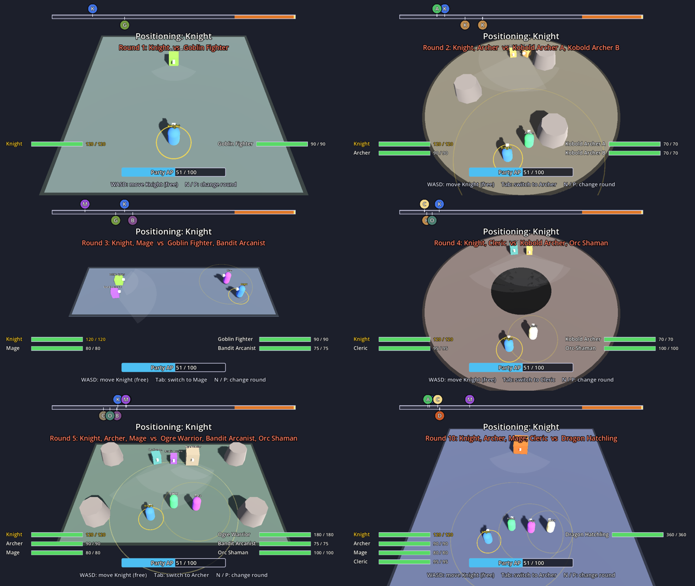

# Prototype JRPG

A 3D JRPG battle system prototype built in **Godot 4.7**. It blends four
classic battle systems into one hybrid:

- **Grandia 2**: a shared timeline that decides who acts next, with a casting
  zone where enemies prepare their moves.
- **Valkyrie Profile 2**: real-time positioning on a 3D battlefield, and
  attacking enemies from the right angle.
- **Mabinogi**: a rock-paper-scissors skill triangle (Attack, Smash, Defense,
  Counter) and reading what the enemy has loaded.
- **Legend of Legaia**: building combos in an AP bar and playing them with
  timed button presses.

Everything is still placeholder art: capsules for the party, boxes for the
enemies. The goal of this stage is a fun core loop, not visuals.

## Boss rush

The game plays as an **11-fight boss rush** (`data/boss_rush.tres`), with a
different party lineup and arena each round, to test how enemies and party
members combine. The title screen also has **Round Select**, and **N / P**
still jump between rounds during a fight.

## Tutorial

**Tutorial** on the title screen is one guided fight against a Training
Golem that teaches every mechanic in 10 lessons: moving, the timeline, combos
and timed hits, Wait, reading enemy skills, Parry and Defend, the skill
triangle, Abilities (the Archer, Mage and Cleric join along the way), max AP,
and rocks. It ends with free practice. Notes pause the fight until you press
J; goals run until you've done them. Nobody can fall, so it can't be lost.

| Round | Party | Enemies | Arena |
|---|---|---|---|
| 1 | Knight | Goblin Fighter | square |
| 2 | Knight, Archer | 2 Kobold Archers | circle with 3 rocks |
| 3 | Knight, Mage | Goblin Fighter, Bandit Arcanist | long rectangle |
| 4 | Knight, Cleric | Kobold Archer, Orc Shaman | circle around a pit |
| 5 | Knight, Archer, Mage | Ogre Warrior, Bandit Arcanist, Orc Shaman | rectangle with 4 rocks |
| 6 | full party | Stone Golem | large arena |
| 7 | full party | Living Armor | large arena |
| 8 | full party | Stone Golem, Kobold Archer, Ogre Warrior | large arena |
| 9 | full party | Living Armor, Orc Shaman, 2 Goblin Fighters | large arena |
| 10 | full party | Dragon Hatchling | large arena |
| Special | full party | Stone Golem, Living Armor, Dragon Hatchling | large arena |

Rocks block movement and line of sight (no attacks through them, either
way). The pit blocks movement only.



## How a battle works

**The timeline.** Every fighter slides along a bar at the top of the screen at
their own speed. Reaching the end means it's their turn. The orange stretch
near the end is the **casting zone**: enemies there are preparing a skill.
Their area appears on the floor in grey right away ("???"), and the skill's
name and color are revealed later. While casting, an enemy turns to follow
whoever it locked onto, and only slows down in the last second: that's when
to slip out.

**Positioning (between turns).** While the timeline runs, you steer one party
member in real time and press **Tab** to switch between them. Enemies and the
AI-controlled allies move too. Each enemy shows its threat area on the floor:
faint while harmless, colored once its skill is revealed. Step into a live
area and the enemy strikes immediately. Each enemy has its own skills and
area shapes: cones, circles, lines and donuts.

**Your turn.** The fighter whose turn it is is locked in place, and a menu
opens: **Attack** (needs an enemy in reach), **Abilities** (one skill, then
the turn ends), or **Wait** (spends no AP and brings the next turn sooner).

**Combos.** Attack asks which enemy to hit when more than one is in reach
(W / S, then J), then opens a Legaia-style combo bar with the class's own
attacks. Fill the bar with party AP (the bar is as long as the class's AP),
then watch a playhead sweep across it. Every hit has a timing box: press **J**
inside it for a **Perfect** hit.

**Enemy strikes.** When an enemy attacks, a ring shrinks onto the target.
Press **E** as it turns gold to **Parry**, or **Q** to **Defend** (costs AP;
the damage you take comes back if you aren't hit again before your next turn).
Not every class can do both (see below).

## Classes

| Class | HP | AP | Block / Parry | Attacks | Skills |
|---|---|---|---|---|---|
| Knight | 200 | 60 | both | Slash, Thrust (ignores Defense), Double Slash, Smash (breaks Defense) | Light Heal, Brace, Shield Bash, Taunt |
| Archer | 150 | 70 | neither | Shoot, Triple Shot, Stunning Arrow, Gale Shot | Jump, Riposte, True Sight, Agility |
| Mage | 100 | 90 | Parry only | Energy Blast, Firebolt, Tempest, Meteor Strike | Arcane Barrier, Concentrate, Teleport |
| Cleric | 130 | 60 | Block only | Bash, Divine Barrier, Holy Light | Healing, Shielding, Haste, Full Cure |

A class's **AP** is the most it can spend in one turn, on a combo or a skill;
the AP itself comes from the shared party pool. Effects that last "3 turns"
count the caster's turns. Every number lives in `scripts/battle/moves.gd`.

**The skill triangle.** Attack beats Smash, Smash breaks Defense, Defense
blocks Attack, and Counter punishes anything that hits it. It applies both to
what enemies throw at you and to what you throw at them.

**AP and risk.** AP is one shared party pool that recharges over time. Every
Parry and Perfect hit raises the party's **max AP** for the rest of the fight,
and a bigger max AP also recharges faster. Missing a Parry or a timed hit
resets max AP to 100, so the better you play, the more you have to lose.

## Controls

| When | Key | Action |
|---|---|---|
| Between turns | WASD / arrows | Move the party member you're steering |
| Between turns | Tab | Switch to the next party member |
| Your turn | W / S, J or Enter | Choose and select in the menu |
| Combo bar | J / K (or Enter / Backspace) | Add a move / remove the last one (or go back) |
| Abilities | W / S, J / K | Choose a skill, use it / go back |
| Choosing a target | W / S (Jump: WASD), J / K | Pick who or where, confirm / go back |
| Combo bar | Space | Begin the combo |
| Combo playing | J or Enter | Timed hit: press inside the box for a Perfect |
| Enemy strike | E | Parry (when the ring turns gold) |
| Enemy strike | Q | Defend (costs AP) |
| Any time | Z / C, or right-drag | Rotate the camera (movement follows it) |
| Any time | Mouse wheel / V | Zoom / reset the camera |
| Any time | Esc | Back to the title screen |
| Any time (not in the tutorial) | N / P | Next / previous round |
| Battle over | R | Restart the round |

Keys can be changed in **Project > Project Settings > Input Map**.

## Running it

1. Install **Godot 4.7** (standard version, not .NET) from godotengine.org.
2. Open Godot, click **Import**, and select this folder's `project.godot`.
3. Press **F5** to play. The game opens on the title screen.

## Project layout

```
scenes/ui/title_menu.tscn         the title screen (main scene): Boss Rush, Tutorial, Round Select, Controls
scenes/battle/battle_arena.tscn   the battle scene; loads the current round or the tutorial
scripts/battle/tutorial.gd        the tutorial's lessons: text, goals, how each one sets up the fight
data/tutorial.tres                the tutorial's fight: training arena, Knight, Training Golem
scenes/arenas/                    one scene per arena: floor shape, rocks, pit, start spots
scenes/characters/                one scene per party member and enemy (stats and skills)
data/boss_rush.tres               the rounds: arena, party lineup, enemies
scripts/battle/arena.gd           arena edges, obstacles, steering, line of sight
scripts/battle/arena_obstacle.gd  a rock (blocks sight) or pit (doesn't)
scripts/battle/encounter.gd       one round's data; boss_rush.gd holds the list
scripts/battle/battle_arena.gd    the battle flow: timeline, turns, strikes, combos, AI
scripts/battle/combatant.gd       shared by every fighter: stats, HP, timeline, enemy skill setup
scripts/battle/skills.gd          the skill triangle: names, colors, default areas
scripts/battle/enemy_skill.gd     one enemy skill: shape, damage, wind-up, rules (edited in the Inspector)
scripts/battle/moves.gd           every class's attacks and skills: AP cost, hits, timing, areas, effects
scripts/battle/attack_range.gd    an enemy's threat area drawn on the floor
scripts/battle/timeline_bar.gd    the turn-order bar
scripts/battle/battle_menu.gd     the command menu and combo bar
scripts/battle/party_status.gd    HP bars
docs/battle-design.md             detailed design notes and open questions
docs/CHANGELOG.md                 how the system evolved, milestone by milestone
backups/                          zipped snapshots from before version control
```

Most tuning numbers are exposed in Godot's **Inspector**: select the
BattleArena node for battle-wide settings (AP, timing windows, battle speed,
which round F5 starts on). Open a character scene in `scenes/characters/` to
change its stats (HP, speed, attack power, reach, combo limit), or an arena
scene in `scenes/arenas/` to move rocks and start spots.

**Designing an enemy:** open its scene and look at **Combat > Skills** in the
Inspector. Each skill has a name, a triangle kind (Attack, Smash, Defense,
Counter), a weight (how often it's picked), an area (cone, circle, line or
donut, with its size), damage, wind-up, and the rules "cannot be parried" and
"cannot be blocked".

## Roadmap

- [x] Arena, timeline and turn order
- [x] Real-time positioning, enemy threat areas, AI allies
- [x] Hidden enemy intent, revealed late in the casting zone
- [x] Enemy strikes with Parry and Defend; HP and knockouts
- [x] Command menu and Legaia-style combo bar with timed hits
- [x] Max AP that grows with skill and resets on mistakes
- [x] Positioning between turns, Wait command (current test setup)
- [x] Enemy template: design enemy skills in the Inspector without code
- [x] Boss rush: 11 rounds, arenas with rocks and a pit, multi-enemy fights
- [x] Classes: Knight, Archer, Mage, Cleric, each with attacks and skills
- [x] Title screen and a guided tutorial
- [ ] Roster building blocks: multi-hit attacks, marked targets, hazards, healing
- [ ] Stagger gauge and knockdown (push away, disable or reshape enemy areas)
- [ ] Complete fight: proper victory and defeat screens, balance pass
- [ ] Abilities and Items

See [`docs/battle-design.md`](docs/battle-design.md) for the full design
reasoning and [`docs/CHANGELOG.md`](docs/CHANGELOG.md) for the history.
