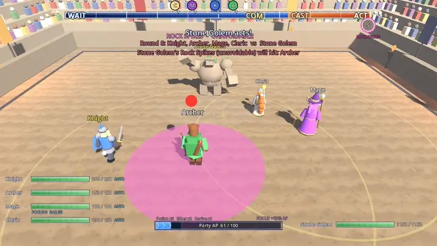
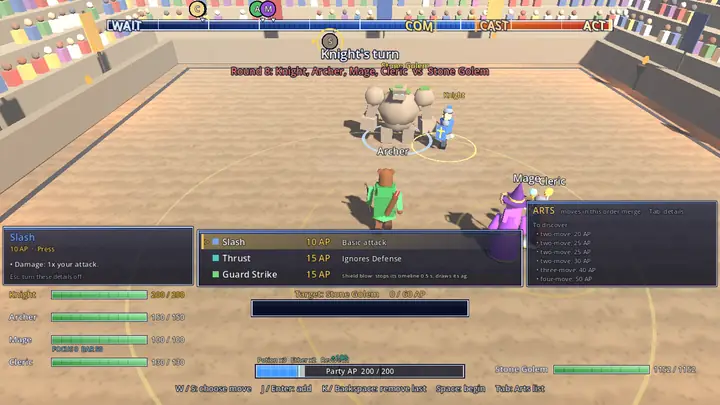
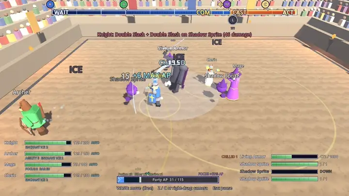
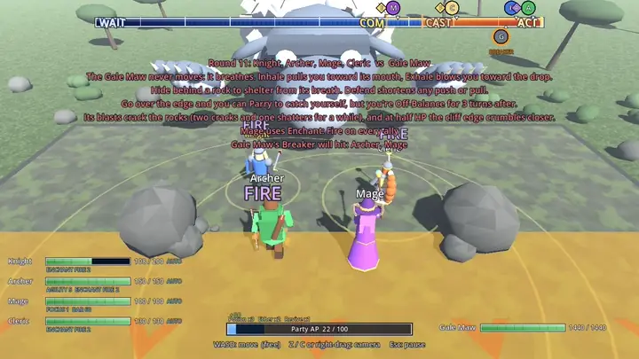
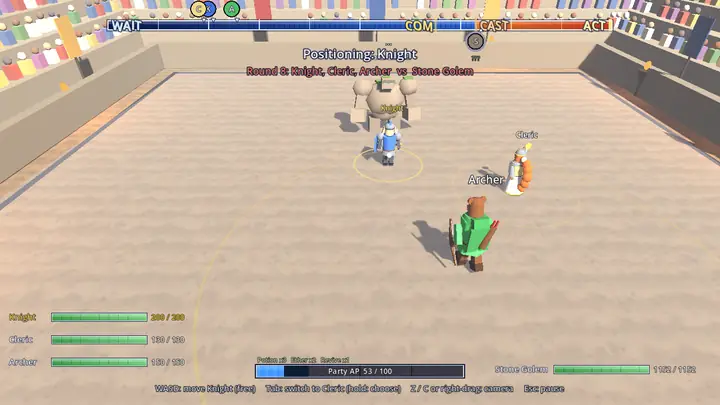
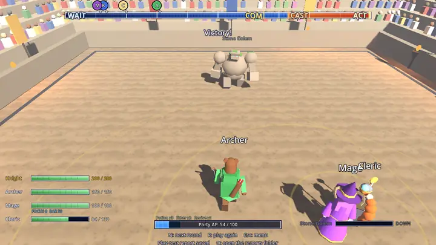
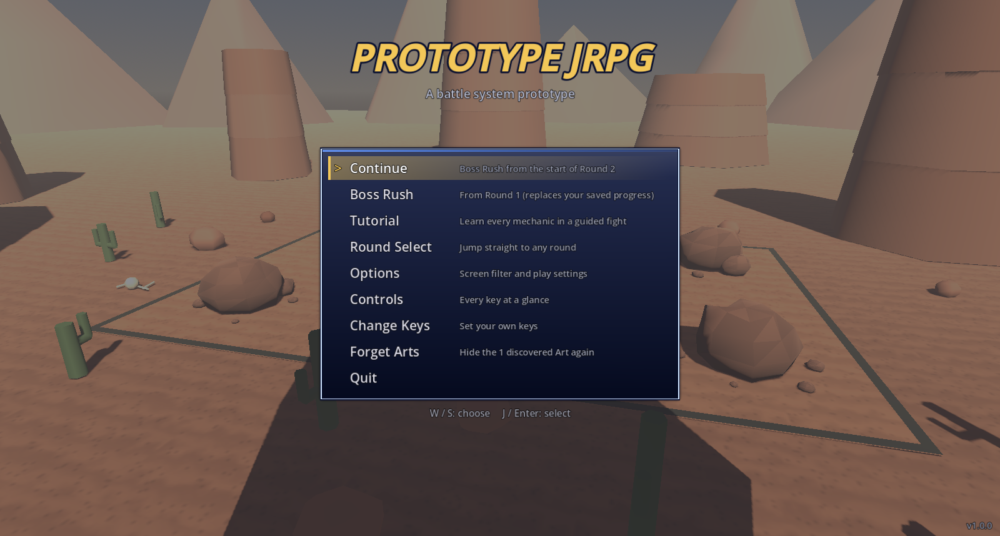

# Prototype JRPG

[](https://discord.gg/FU89dNTwz)

A 3D JRPG battle system prototype built in **Godot 4.7**, mixing four classic
battle systems:

- **Grandia 2**: a shared timeline, with a casting zone where enemies prepare their moves
- **Valkyrie Profile 2**: real-time positioning, and angles that matter
- **Mabinogi**: a skill triangle (Attack, Smash, Defense, Counter) and reading the enemy
- **Legend of Legaia**: combos built in an AP bar, timed button presses, and secret Arts

A PS1-style look with a furry cast: low-poly animal heroes and enemies, smooth
animation, a retro screen filter (Normal, Light or Off), and a place for every arena.



| | |
|---|---|
|  |  |
| **Combos and Arts:** fill the bar, hit each timing as the ring closes in, and find secret Arts mid-combo | **Living Armor:** hit each Shadow Sprite before the circle fills the room |
|  |  |
| **Gale Maw:** dodge the Gale Lanes and push the Gust Sprites off the ledge | **Strong blows throw you:** a Smash sends a downed fighter flying |
|  |  |
| **Every fight is ranked:** the last enemy falls in slow motion, then a rank for Health, Timing, Reading and Pace, with a summary of where it came from | **Title screen:** an arena turns slowly behind Boss Rush, Tutorial, Round Select and more |

## What's in it

- **A boss rush of 13 rounds plus a Special Match**, with auto-save, Round Select, and a party picker for the boss rounds (1 to 4 fighters, solo allowed)
- **Four bosses with their own mechanics:** the Stone Golem's rocks that stay and explode, the Living Armor's Shadow Sprites, the Dragon Hatchling, and the Gale Maw, which pushes you toward a cliff edge
- **Six classes**: Knight, Archer, Mage, Cleric, Assassin and Monk, each with its own attacks, Abilities, reactions and secret **Arts** (the Mage types her spells as element codes while they cast, and mixes them into 19 Arts)
- **Items**: a shared pouch per fight (3 Potions, 2 Ethers, 1 Revive), used in the turn's Ability slot
- **Enemies with readable skills**: cones, lines, donuts, half-room cleaves, falling rocks, instant-death gazes you hide from, and more
- **Arenas with drops**: holes and lethal edges you can knock enemies into, or be thrown into yourself
- **Party AI** that dodges revealed attacks, keeps off ledges, heals, revives, and splits up to answer boss mechanics
- **Victory and Defeat screens**: a rank from S to C with a Fight summary after a win, and a *What went wrong* page with a tip after a loss
- **Ragdolls**: strong blows knock fighters down and throw them across the arena, and the last enemy of a fight falls in slow motion
- **Sound and music**: hits, spells, Parries and menus all have sounds, with music for every fight, the bosses and the menus (all CC0)
- **Controller support** (Xbox layout): play the whole game on a gamepad, with on-screen prompts that switch to its buttons and rebindable buttons
- **Options**: screen filter, master, music and sound volume, camera speed, mouse sensitivity and invert, Party AI and more
- **A guided tutorial** that teaches every mechanic, step by step, and a **Command List** in the pause menu (Esc) to preview and practise every move
- **Play-test reports** written after every fight (*Open play-test report* on the end screen, or O)

## How a fight works

Everyone slides along the **timeline** at the top. While it runs you **steer**
one party member in real time (Tab switches who), and the others move on
their own. Enemies entering the **CAST** zone prepare a skill: first a grey
area on the floor, then the real one, revealed late. Get out of it before it
lands, or **Parry** (E / RB) or **Defend** (Q / LB) the strike.

**Your turn comes in two steps (Windup).** When a fighter reaches the gold
**command point**, time stops and you choose: **Attack** (any enemy, near or
far), one **Ability** (and you can still attack after it), or **Wait**. Then
time runs again while that fighter winds up toward **ACT**; get them in reach
of their target before they get there. Out of reach, the turn turns into a
Wait. Prefer the old way? *Command timing: Classic* in Options opens
the menu right at the end of the bar.

**Attacking** opens a combo bar: fill it with moves, then hit each timing as
the playhead passes (Press, Hold or Tap) for a **Perfect**; a ring closing in
on the target shows the same timing, so you can watch the fight instead of the
bar. Moves in the right
order merge into **Arts**, secret until you find them mid-combo. Each move
shows tags for how it answers what the enemy is doing right now (breaks
Defense, interrupts, pushes, and so on). Hit an enemy in **Counter** stance and
the playhead stops: press the hit key again on the beat to **parry it**,
break the stance and power up the rest of the combo.

**AP** is shared by the whole party. Perfects and Parries raise its maximum
for the rest of the fight; a missed Perfect or Parry drops it back to 100.

**Bosses push back:** cancel one of their skills and they shrug off the next
few cancels, and their biggest moves can't be stopped at all. Unavoidable
skills fill a **Stagger** bar instead: fill it with hits to break the cast.

**Items** come from a pouch the whole party shares: 3 Potions, 2 Ethers and
1 Revive per fight. Using one takes the turn's Ability slot, and you can still
attack after it.

**When the fight ends,** a small panel over the battle gives a **rank** (S to
C: Health, Timing, Reading and Pace) and the way on: Next round, Retry, Change
party, the play-test report or back to the menu. After a defeat, *What went
wrong* shows what hurt most, who went down to what, and a tip.

**Rather steer just one?** Turn on *Party AI* in Options (title screen or Esc): everyone you
aren't steering plays their own turns instantly (with the Arts you've found),
leaving AP for yours. Tab still takes any of them over.

## How to play

**Current build: [1.0.0](../../releases/tag/v1.0.0)** (all builds are on the [Releases](../../releases) page)

**Download (Windows):** get
[`PrototypeJRPG-1.0.0-windows.zip`](../../releases/download/v1.0.0/PrototypeJRPG-1.0.0-windows.zip),
unzip it and run `Prototype JRPG.exe`. No install needed. Windows may warn
about an unknown app the first time: choose *More info > Run anyway*.

**Download (Linux, x86_64):** get
[`PrototypeJRPG-1.0.0-linux.tar.gz`](../../releases/download/v1.0.0/PrototypeJRPG-1.0.0-linux.tar.gz), then:

```
tar -xzf PrototypeJRPG-1.0.0-linux.tar.gz
./"Prototype JRPG.x86_64"
```

The version is shown on the title screen; what changed in each one is in
[`docs/RELEASES.md`](docs/RELEASES.md).

**From source (any platform):** install **Godot 4.7** (standard, not .NET),
click **Import**, pick this folder's `project.godot`, and press **F5**.

**First steps:**

1. Start with **Tutorial** on the title screen. It teaches everything step by step, and you can't lose.
2. Then play **Boss Rush**: 13 rounds that get harder, then a Special Match, with auto-save (**Continue** picks up where you left off).
3. Stuck on a round? **Round Select** jumps to any of them.

**Feedback is very welcome!** After every fight the game writes a short
report; choose *Open play-test report* (or press **O**) on the end screen to open the folder (on Windows,
`%APPDATA%\Godot\app_userdata\Prototype JRPG\playtests`). Attach a few to an
[issue](../../issues) along with what felt fun, confusing or unfair.

## Community

Join the [Discord server](https://discord.gg/FU89dNTwz) to share feedback,
get new releases as they come out, and ask the game's bot anything with
`/ask` (for example `/ask how does the counter-parry work?`).

## Controls (defaults)

| Keyboard | Controller (Xbox layout) | Action |
|---|---|---|
| WASD | Left stick / D-pad | Move the fighter you steer / choose in menus |
| Tab | Y | Switch party member (hold: stop time and choose) / open the Arts list in the combo bar |
| J / K (Enter / Backspace) | A / B | Confirm / back; J or A is also the timed-hit button (and parries a Counter) |
| Space | X | Begin the combo |
| E / Q | RB / LB | Parry / Defend an enemy strike |
| Z / C, right-drag, wheel | Right stick | Turn the camera (the stick also tilts it) |
| V | RS click | Reset the camera |
| Esc | Menu | Pause: Command List, Options, Change Keys, Restart, Quit |
| W / S, J (end screen) | Up / Down, A | Choose and pick: Next round, Retry, Change party, and more (O opens the play-test reports) |

Keys and buttons can be rebound in **Change Keys** (title screen or Esc). On-screen
hints switch to controller buttons as soon as you use the pad. Camera speed, mouse
sensitivity and Invert camera (X, Y or both) are in **Options**.

## Learn more

- [`docs/battle-design.md`](docs/battle-design.md): every rule and number in detail
- [`docs/enemy-roster.md`](docs/enemy-roster.md): enemies and their skills
- [`docs/RELEASES.md`](docs/RELEASES.md): what changed in each public build
- [`docs/CHANGELOG.md`](docs/CHANGELOG.md): how the system evolved

## Roadmap

- [x] Arena, timeline and turn order
- [x] Real-time positioning, enemy threat areas, AI allies
- [x] Hidden enemy intent, revealed late in the casting zone
- [x] Enemy strikes with Parry and Defend; HP and knockouts
- [x] Command menu and Legaia-style combo bar with timed hits
- [x] Max AP that grows with skill and resets on mistakes
- [x] Positioning between turns, Wait command (current test setup)
- [x] Enemy template: design enemy skills in the Inspector without code
- [x] Boss rush: 12 rounds, arenas with rocks and a pit, multi-enemy fights
- [x] Classes: Knight, Archer, Mage, Cleric, Assassin, Monk, each with attacks and skills
- [x] Timing types: Press, Hold and Release, Tap; positionals and Marks (Assassin)
- [x] Arts: secret named combos for every class, revealed mid-combo
- [x] Title screen and a guided tutorial
- [x] Pause menu, Boss Rush auto-save, rebindable keys, party picker for boss rounds
- [x] Roster building blocks: multi-hit attacks, marked targets, hazards, healing
- [x] Play-test reports after every fight (O on the end screen opens them)
- [x] Stagger bars: break unavoidable casts with hits
- [x] Windup turns (Grandia-style), counter-parry, boss cancel resistance
- [x] HUD restyle; move tags that show how each move answers the enemy
- [x] Bosses with set-piece mechanics: Golem rocks, Shadow Sprites, Gust Sprites
- [x] Knockdown (push away, disable or reshape enemy areas): Stagger bars, pushes and pulls, interrupts
- [x] Complete fight: victory and defeat screens with a rank, balance pass
- [x] Items: a pouch per fight (Potion, Ether, Revive), one per turn in the Ability slot
- [x] PS1 look: furry low-poly figures, animations for every move, physics ragdolls, arenas that are places
- [x] Sound and music, controller support, Options (volume, camera, screen filter)
