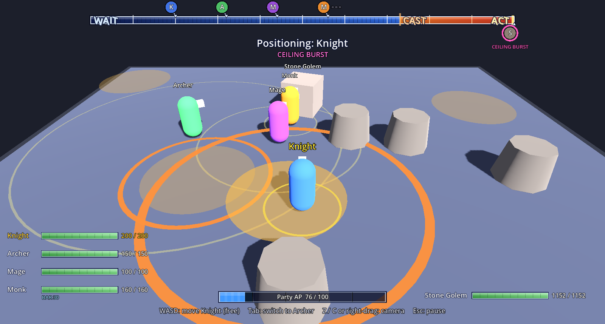
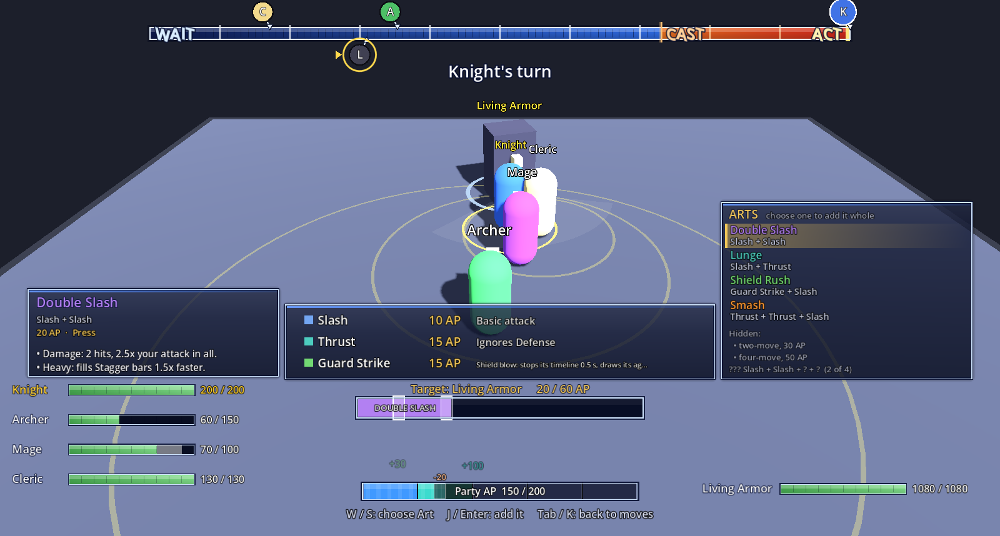
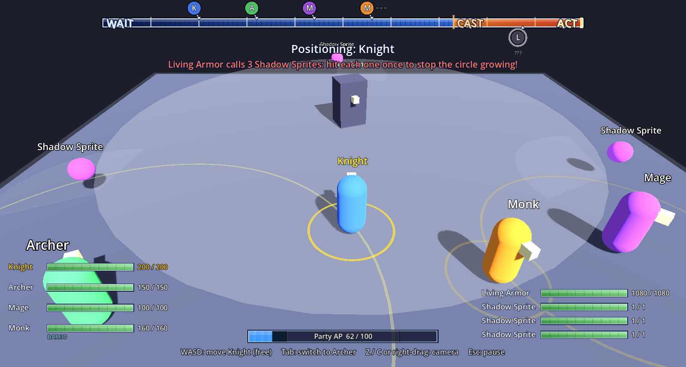
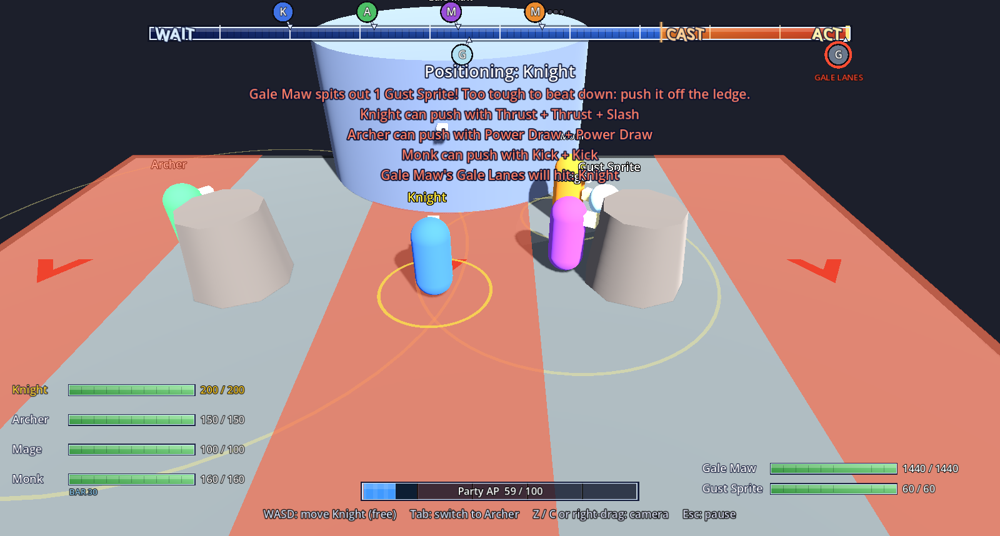
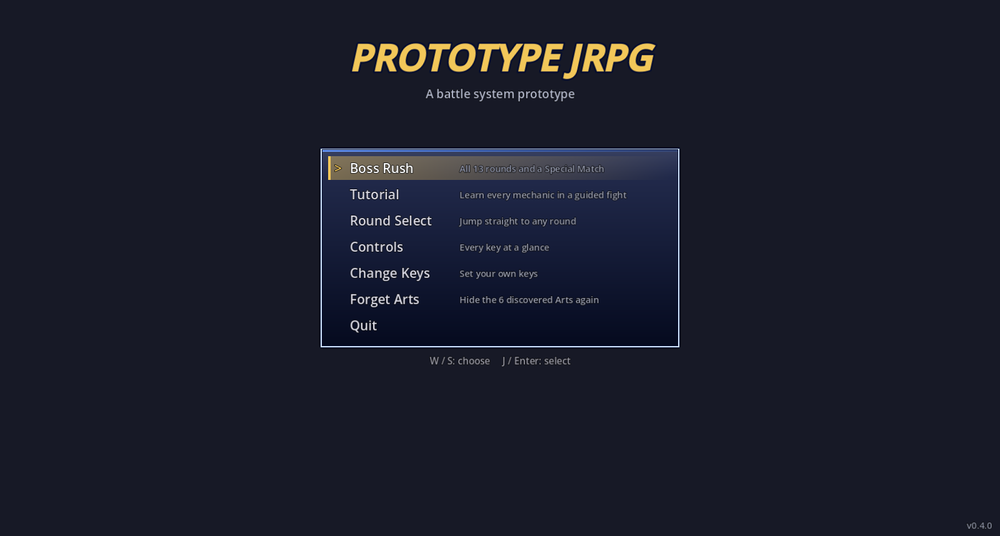

# Prototype JRPG

A 3D JRPG battle system prototype built in **Godot 4.7**, mixing four classic
battle systems:

- **Grandia 2**: a shared timeline, with a casting zone where enemies prepare their moves
- **Valkyrie Profile 2**: real-time positioning, and angles that matter
- **Mabinogi**: a skill triangle (Attack, Smash, Defense, Counter) and reading the enemy
- **Legend of Legaia**: combos built in an AP bar, timed button presses, and secret Arts

Placeholder art throughout (capsules and boxes): this stage is about a fun core loop.
The screenshots are from the latest source, so a few things in them arrive with the next build.



| | |
|---|---|
|  |  |
| **Combos and Arts:** fill the bar with moves; the right order merges them into secret Arts | **Living Armor:** hit each Shadow Sprite once to stop the growing circle |
|  |  |
| **Gale Maw:** dodge the Gale Lanes and push the tough Gust Sprite off the ledge | **Title screen:** Boss Rush, Tutorial, Round Select and more |

## What's in it

- **A boss rush of 13 rounds plus a Special Match**, with auto-save, Round Select, and a party picker for the boss rounds (1 to 4 fighters, solo allowed)
- **Four bosses with their own mechanics:** the Stone Golem's rocks that stay and explode, the Living Armor's Shadow Sprites, the Dragon Hatchling, and the Gale Maw, which pushes you toward a cliff edge
- **Six classes**: Knight, Archer, Mage, Cleric, Assassin and Monk, each with its own attacks, Abilities, reactions and secret **Arts**
- **Enemies with readable skills**: cones, lines, donuts, half-room cleaves, falling rocks, instant-death gazes you hide from, and more
- **Arenas with drops**: holes and lethal edges you can knock enemies into, or be thrown into yourself
- **A guided tutorial** that teaches every mechanic, step by step
- **Play-test reports** written after every fight (press O on the end screen)

## How a fight works

Everyone slides along the **timeline** at the top. While it runs you **steer**
one party member in real time (Tab switches who), and the others move on
their own. Enemies entering the **CAST** zone prepare a skill: first a grey
area on the floor, then the real one, revealed late. Get out of it before it
lands, or **Parry** (E) or **Defend** (Q) the strike.

**Your turn comes in two steps (Windup).** When a fighter reaches the gold
**command point**, time stops and you choose: **Attack** (any enemy, near or
far), one **Ability** (and you can still attack after it), or **Wait**. Then
time runs again while that fighter winds up toward **ACT**; get them in reach
of their target before they get there. Out of reach, the turn turns into a
Wait. Prefer the old way? *Command timing: Classic* in the pause menu opens
the menu right at the end of the bar.

**Attacking** opens a combo bar: fill it with moves, then hit each timing as
the playhead passes (Press, Hold or Tap) for a **Perfect**. Moves in the right
order merge into **Arts**, secret until you find them mid-combo. Each move
shows tags for how it answers what the enemy is doing right now (breaks
Defense, interrupts, pushes, and so on). Hit an enemy in **Counter** stance and
the playhead stops: press the hit key again on the beat to **parry it**,
break the stance and power up the rest of the combo.

**AP** is shared by the whole party. Perfects and Parries raise its maximum
for the rest of the fight; a missed Perfect or Parry drops it back to 100.

**Bosses push back:** cancel one of their skills and they shrug off the next
few cancels, and their biggest moves can't be stopped at all. Unavoidable
skills fill a **Stagger** bar instead: fill it with hits to break the cast.

## How to play

**Current build: [0.4.0](../../releases/tag/v0.4.0)** (pre-release; all builds are on the [Releases](../../releases) page)

**Download (Windows):** get
[`PrototypeJRPG-0.4.0-windows.zip`](../../releases/download/v0.4.0/PrototypeJRPG-0.4.0-windows.zip),
unzip it and run `Prototype JRPG.exe`. No install needed. Windows may warn
about an unknown app the first time: choose *More info > Run anyway*.

**Download (Linux, x86_64):** get
[`PrototypeJRPG-0.4.0-linux.tar.gz`](../../releases/download/v0.4.0/PrototypeJRPG-0.4.0-linux.tar.gz), then:

```
tar -xzf PrototypeJRPG-0.4.0-linux.tar.gz
./"Prototype JRPG.x86_64"
```

The version is shown on the title screen; what changed in each one is in
[`docs/RELEASES.md`](docs/RELEASES.md).

**From source (any platform):** install **Godot 4.7** (standard, not .NET),
click **Import**, pick this folder's `project.godot`, and press **F5**.

**First steps:**

1. Start with **Tutorial** on the title screen. It teaches everything step by step, and you can't lose.
2. Then play **Boss Rush**: 13 rounds that get harder, then a Special Match, with auto-save (**Continue** picks up where you left off).
3. Stuck on a round? **Round Select** jumps to any of them.

**Feedback is very welcome!** After every fight the game writes a short
report; press **O** on the end screen to open the folder (on Windows,
`%APPDATA%\Godot\app_userdata\Prototype JRPG\playtests`). Attach a few to an
[issue](../../issues) along with what felt fun, confusing or unfair.

## Controls (defaults)

| Key | Action |
|---|---|
| WASD | Move the fighter you steer / choose in menus |
| Tab | Switch party member / open the Arts list in the combo bar |
| J / K (Enter / Backspace) | Confirm / back; J is also the timed-hit key (and parries a Counter) |
| Space | Begin the combo |
| E / Q | Parry / Defend an enemy strike |
| Z / C, right-drag, wheel | Camera (V resets it) |
| Esc | Pause (settings, Command timing) |
| R / O (end screen) | Fight again / open the play-test reports |

**Change Keys** on the title screen rebinds them.

## Learn more

- [`docs/battle-design.md`](docs/battle-design.md): every rule and number in detail
- [`docs/enemy-roster.md`](docs/enemy-roster.md): enemies and their skills
- [`docs/RELEASES.md`](docs/RELEASES.md): what changed in each public build
- [`docs/CHANGELOG.md`](docs/CHANGELOG.md): how the system evolved

## Roadmap

- [x] Arena, timeline and turn order
- [x] Real-time positioning, enemy threat areas, AI allies
- [x] Hidden enemy intent, revealed late in the casting zone
- [x] Enemy strikes with Parry and Defend; HP and knockouts
- [x] Command menu and Legaia-style combo bar with timed hits
- [x] Max AP that grows with skill and resets on mistakes
- [x] Positioning between turns, Wait command (current test setup)
- [x] Enemy template: design enemy skills in the Inspector without code
- [x] Boss rush: 12 rounds, arenas with rocks and a pit, multi-enemy fights
- [x] Classes: Knight, Archer, Mage, Cleric, Assassin, Monk, each with attacks and skills
- [x] Timing types: Press, Hold and Release, Tap; positionals and Marks (Assassin)
- [x] Arts: secret named combos for every class, revealed mid-combo
- [x] Title screen and a guided tutorial
- [x] Pause menu, Boss Rush auto-save, rebindable keys, party picker for boss rounds
- [x] Roster building blocks: multi-hit attacks, marked targets, hazards, healing
- [x] Play-test reports after every fight (O on the end screen opens them)
- [x] Stagger bars: break unavoidable casts with hits
- [x] Windup turns (Grandia-style), counter-parry, boss cancel resistance
- [x] HUD restyle; move tags that show how each move answers the enemy
- [x] Bosses with set-piece mechanics: Golem rocks, Shadow Sprites, Gust Sprites
- [ ] Knockdown (push away, disable or reshape enemy areas)
- [ ] Complete fight: proper victory and defeat screens, balance pass
- [ ] Items (the menu entry is there, marked "coming later")
